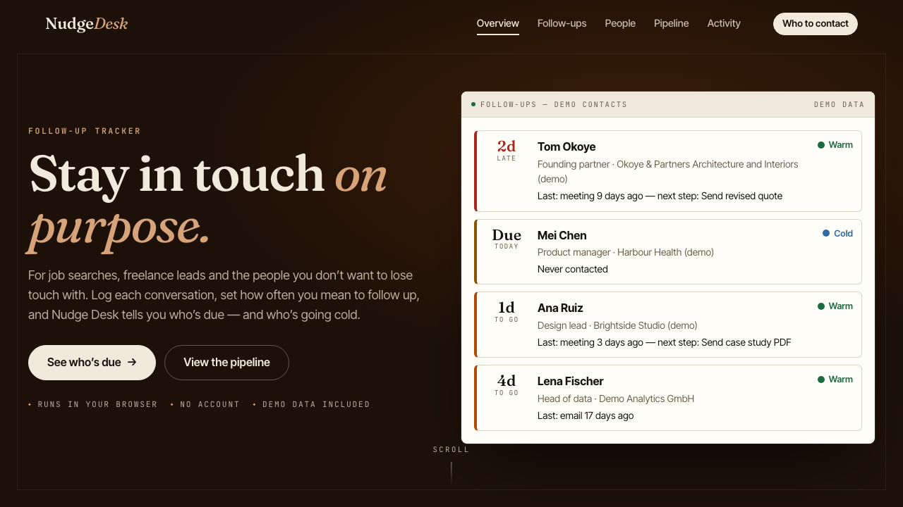
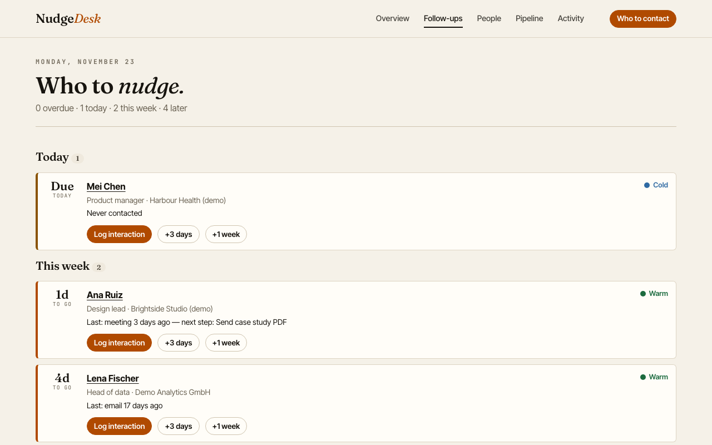
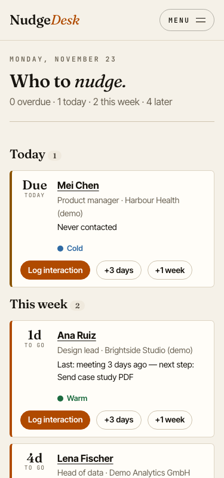

# Nudge Desk

A follow-up tracker for job searches, freelance leads and the people you don’t want to lose touch with. Log each conversation, set how often you mean to follow up, and work a daily queue of who’s overdue, due today or due this week.

**Live demo:** [https://nudge-desk-app.vercel.app/](https://nudge-desk-app.vercel.app/) — runs entirely in your browser; demo data is fictional and labelled.



| Follow-ups | Mobile |
| --- | --- |
|  |  |

## Run it

```bash
npm install
npm run dev        # http://localhost:5213
npm test
npm run build
npm run test:e2e   # Playwright smoke test (npm run e2e:install once if Chromium is missing)
```

## Main workflow

1. The app opens with eight labelled, fictional **demo contacts** at every pipeline stage and three months of interactions. **People → Clear demo contacts** removes them.
2. **Follow-ups** → overdue, today and this week, each with last contact, the agreed next step and a warmth indicator. **Log interaction** opens an inline form; **+3 days** and **+1 week** snooze.
3. **People** → add someone with a follow-up rhythm (e.g. every 30 days). The table sorts and filters by stage and text; export every interaction as CSV.
4. A person’s page has their history timeline, a log form with the next follow-up pre-filled from the rhythm, and settings for stage, rhythm and a specific follow-up date.
5. **Pipeline** → five stages with ←/→ buttons. **Activity** → interactions per week for 12 weeks, stacked by type, with averages and a count of cold relationships.

## Rules

- **Next follow-up** = a specific date if set; otherwise last interaction + rhythm; someone with a rhythm but no interactions is due today. Closed contacts and people without a rhythm never appear in the queue.
- Logging an interaction clears a specific date unless you choose a different one; “New” contacts move to “Reached out”.
- **Warmth**: warm within the rhythm, cooling up to 1.5× the rhythm, cold beyond that or if never contacted.
- Interactions can’t be logged in the future, and a next follow-up can’t be in the past.

## Design

Shared editorial system: Fraunces display type, Inter Tight interface text, mono labels, urgency carried by the left border and the day count, warmth shown with colour plus a text label, an ink hero whose preview is the real queue, and a warm paper workspace. Motion is disabled under `prefers-reduced-motion`.

## Tests

- `src/lib/nudge.test.ts` — follow-up date rules, due states, latest contact, warmth thresholds, queue ordering, logging and snoozing, weekly counts, validation.
- `src/App.test.tsx` — urgency groups, snooze, inline logging with validation, adding a person, pipeline move and activity chart.
- `e2e/smoke.spec.ts` — landing, log from the queue with reload persistence, person history, add a person, pipeline, activity, plus 375px layout checks.

## Limitations

- No email or calendar integration — it never contacts anyone.
- One device only.

## Future improvements

- Calendar (.ics) export of follow-ups; tags as filters on the queue.

## Licence

MIT — see [LICENSE](LICENSE).
